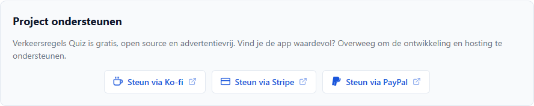
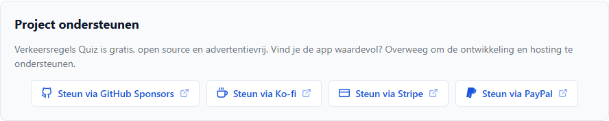
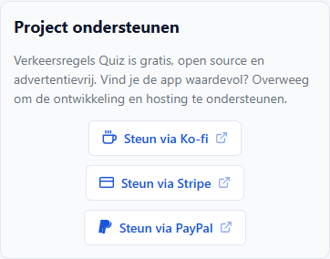
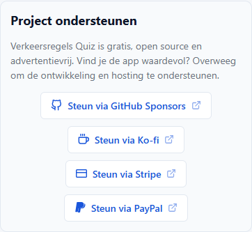
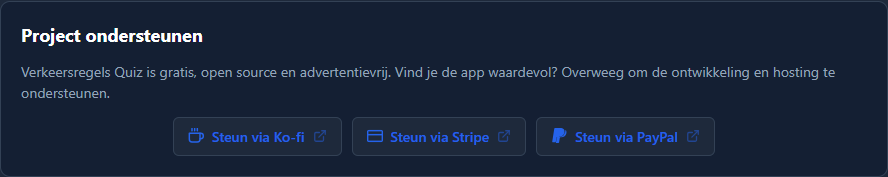
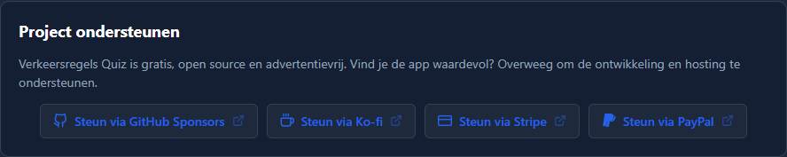
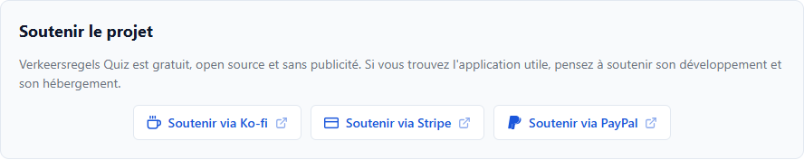
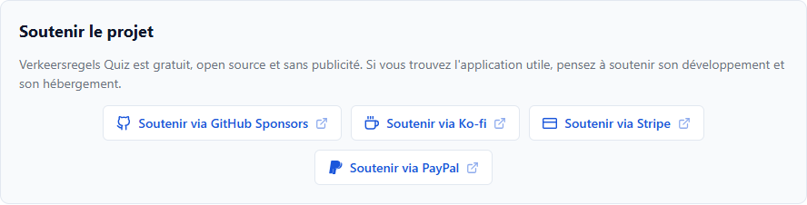

# T0087: Walkthrough & Validation

## Red Phase
Command: `python -m pytest tests/test_about_view.py -q` (exit code 1, assertion lines filtered with grep; long lines cut)

```text
E       AssertionError: False is not true : .github/FUNDING.yml must exist
E       AssertionError: 'id="about-support-github"' not found in '<!DOCTYPE html>\\n<html lang="nl">\\n<head>\\n  <meta charset="UTF-8">\\n  <meta name="viewpor [...]
E           AssertionError: 'GitHub Sponsors' not found in '' : strings.de.json must define about.support_github
3 failed, 3 passed in 0.12s
```

## Green Phase
Command: `python -m pytest tests -q` (exit code 0)

```text
........................................................................ [ 41%]
........................................................................ [ 82%]
...............................                                  [100%]
175 passed, 8 subtests passed in 2.05s
```

## Visual Verification
Server: `python scripts/run-review-server.py serve --port 8087 --host 127.0.0.1`; `index.html` returned HTTP 200.
Harness: Playwright with installed Chrome, service workers blocked, `?view=about`.
Gate: zero console errors, page errors, failed requests, and HTTP 400+ responses.

```text
desktop: links=['Steun via GitHub Sponsors', 'Steun via Ko-fi', 'Steun via Stripe', 'Steun via PayPal'] icons=[1, 1, 1, 1]
mobile: links=['Steun via GitHub Sponsors', 'Steun via Ko-fi', 'Steun via Stripe', 'Steun via PayPal'] icons=[1, 1, 1, 1]
dark: links=['Steun via GitHub Sponsors', 'Steun via Ko-fi', 'Steun via Stripe', 'Steun via PayPal'] icons=[1, 1, 1, 1]
fr: links=['Soutenir via GitHub Sponsors', 'Soutenir via Ko-fi', 'Soutenir via Stripe', 'Soutenir via PayPal'] icons=[1, 1, 1, 1]
problems: none
```

| View    | Before                                   | After                                  |
| :------ | :--------------------------------------- | :------------------------------------- |
| Desktop |             |             |
| Mobile  |              |              |
| Dark    |                |                |
| French  |                  |                  |
